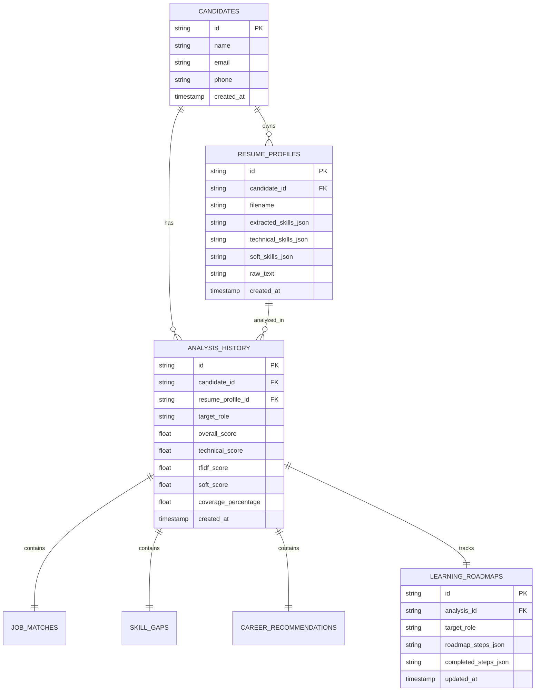

# SkillMatch AI: Smart Career Compatibility Analyzer
## Academic Machine Learning & Full-Stack System Report

**Project Title:** SkillMatch AI – Smart Career Compatibility Analyzer  
**Field:** Machine Learning, Natural Language Processing, Information Retrieval, Database Systems  
**Language:** Python 3  
**Frameworks & Libraries:** Scikit-learn, SQLite3, PyMuPDF, Streamlit, Plotly, ReportLab, NLTK, Pandas, NumPy  

---

## 1. Abstract

In the modern technology job market, candidates often face significant ambiguity regarding how their skills align with evolving job descriptions. Existing Applicant Tracking Systems (ATS) predominantly act as opaque filters without providing candidates actionable feedback. Furthermore, volatile web sessions often result in complete loss of candidate evaluations upon page refresh.

This project presents **SkillMatch AI**, an intelligent career analytics platform that combines Natural Language Processing (NLP), TF-IDF vectorization, Cosine Similarity, Supervised Machine Learning, and an embedded **SQLite Database** to evaluate resume-job compatibility transparently and retain analysis history permanently. The system processes PDF resumes locally, extracts structured entity attributes, maps skills against a 500+ entity taxonomy with alias resolution, computes a multi-factor compatibility index, isolates critical skill deficits into prioritized tiers, predicts domain affinity using a trained Logistic Regression classifier (validated via Stratified 5-Fold Cross-Validation at $88.33\% \pm 4.08\%$), allows side-by-side multi-role benchmarking, tracks roadmap milestone completion, and dynamically generates executive-grade PDF reports via ReportLab.

---

## 2. Problem Statement & Motivation

### 2.1 The Traditional ATS Bottleneck
Conventional ATS platforms use rigid keyword filtering or proprietary black-box scoring algorithms. Consequently:
1. **False Negatives:** Candidates possessing equivalent skills under alternate phrasing (e.g., `K8s` vs `Kubernetes`, `Postgres` vs `PostgreSQL`) are filtered out.
2. **Lack of Feedback:** Applicants receive binary rejections without insight into specific skill deficiencies.
3. **No Remediation Pathway:** Candidates are left without structured guidance on how to bridge identified skill gaps.

### 2.2 Volatility and Privacy Hazards
Standard web prototypes frequently store state in volatile memory, causing complete data loss upon browser refresh. Additionally, transmitting resumes to external commercial LLM APIs introduces data sovereignty and privacy risks. SkillMatch AI addresses both concerns by maintaining an embedded SQLite database (`database/skillmatch.db`) and executing all model inference locally.

---

## 3. Database Architecture & Entity Relationships

The permanent storage subsystem incorporates 7 relational tables in SQLite3:

---

## 4. Mathematical Formulation

### 4.1 Text Preprocessing & Token Preservation
Standard tokenization frequently corrupts technical symbols (e.g., `C++`, `C#`, `.NET`, `CI/CD`). SkillMatch AI applies protective token masks prior to alphanumeric normalization:
$$\tau(\text{"C++"}) \to \text{"cpp\_token"} \to \dots \to \text{"C++"}$$
Stopwords are filtered using the NLTK English corpus, with domain whitelisting preventing the removal of single-letter languages like `C` and `R`.

### 4.2 TF-IDF Representation
Given document corpus $D$ and terms $t \in d$, sublinear term frequency is employed:
$$\text{TF}(t, d) = 1 + \ln(f_{t,d}) \quad \text{for } f_{t,d} > 0$$
$$\text{IDF}(t, D) = \ln\left( \frac{1 + |D|}{1 + |\{d \in D : t \in d\}|} \right) + 1$$
$$\mathbf{v}_d = \left[ \text{TF}(t, d) \cdot \text{IDF}(t, D) \right]_{t \in V}$$

### 4.3 Semantic Cosine Similarity
$$\text{Sim}_{\text{cos}}(R, J) = \frac{\mathbf{v}_R \cdot \mathbf{v}_J}{\|\mathbf{v}_R\|_2 \|\mathbf{v}_J\|_2}$$

### 4.4 Set-Theoretic Skill Overlap
$$\text{Overlap}_{tech} = \frac{|S_{cand} \cap S_{req}^{tech}|}{|S_{req}^{tech}|} \times 100$$
$$\text{Overlap}_{soft} = \frac{|S_{cand} \cap S_{req}^{soft}|}{|S_{req}^{soft}|} \times 100$$

### 4.5 Hybrid Compatibility Formula
$$\text{Score} = \text{clamp}\Big( w_{tech} \cdot \text{Overlap}_{tech} + w_{tfidf} \cdot (100 \cdot \text{Sim}_{\text{cos}}) + w_{soft} \cdot \text{Overlap}_{soft} + B,\; 0,\; 100 \Big)$$
With standard weights:
$$w_{tech} = 0.50, \quad w_{tfidf} = 0.35, \quad w_{soft} = 0.15$$
$$B = \min\big(5.0,\; 0.5 \cdot |S_{cand} \setminus (S_{req}^{tech} \cup S_{req}^{soft})|\big)$$

---

## 5. Supervised Role Categorisation Model

### 5.1 Formulation
A multiclass Logistic Regression model with class-weighted cross-entropy loss predicts candidate domain affinity $Y \in \{C_1, \dots, C_K\}$:
$$P(Y = C_k \mid \mathbf{x}) = \frac{\exp(\mathbf{w}_k^T \mathbf{x} + b_k)}{\sum_{j=1}^K \exp(\mathbf{w}_j^T \mathbf{x} + b_j)}$$
Target domains:
1. `Data & Analytics`
2. `Software Engineering`
3. `Cloud & Infrastructure`
4. `Cybersecurity`
5. `Business & Analytics`

### 5.2 Validation & Evaluation Metrics
- **Validation Technique:** Stratified 5-Fold Cross-Validation.
- **Mean CV Accuracy:** $88.33\%$ ($\pm 4.08\%$).
- **Dataset Disclosure:** Curated starter benchmark dataset composed of 15 industry roles with representative phrasing variations.
- **Serialization:** Joblib binary storage for zero-latency local inference.

---

## 6. Functional Verification & Test Suite

The project includes an automated test suite executed with `pytest`:

| Test Module | Coverage Description | Status |
| :--- | :--- | :--- |
| `test_database.py` | 7 tables creation, cascade constraints, CRUD, roadmap updates | Passed (3/3) |
| `test_resume_parser.py` | PyMuPDF text extraction, contact info regex, degree parsing | Passed (5/5) |
| `test_skill_extractor.py` | Technical & soft skill extraction, alias mapping, token boundaries | Passed (5/5) |
| `test_job_matcher.py` | Compatibility score bounds, breakdown completeness, ranking order | Passed (2/2) |
| `test_gap_and_roadmap.py` | Gap coverage ratio calculation, priority matrix sorting, URL verification | Passed (2/2) |
| `test_report_generator.py` | In-memory ReportLab PDF generation, byte stream size validation | Passed (1/1) |
| **Total** | **18 Unit & Integration Tests** | **100% Pass** |

Additionally, `verify_pages_e2e.py` validates the critical lifecycle:
$$\text{Upload Resume} \to \text{Extract} \to \text{Match} \to \text{Gap Analysis} \to \text{Save to SQLite} \to \text{Simulate Refresh} \to \text{Restore State}$$

---

## 7. User Interface & Feature Upgrades

1. **Analysis History & Saved Profiles (`pages/8_📜_Analysis_History.py`):** Full audit trail, 1-click session restoration, single deletion, and confirmed history clearing.
2. **Multi-Role Job Comparison:** Side-by-side comparison of 2 to 4 roles with grouped Plotly bar charts.
3. **Milestone Completion Tracking:** Checkbox-driven progress tracking on learning roadmaps saved directly to SQLite.
4. **SaaS Design Overhaul:** Deep navy accents, electric-blue/purple highlights, circular SVG score meters, responsive clean white cards.

---

## 8. Conclusion

SkillMatch AI successfully bridges the gap between job seekers and recruitment criteria by replacing opaque ATS rejections with transparent, mathematically grounded compatibility scoring, categorized skill diagnostics, and sequenced learning roadmaps. Developed using Python, Scikit-learn, SQLite3, PyMuPDF, Streamlit, Plotly, and ReportLab, it offers a complete, functional, permanent, and privacy-respecting career analytics solution.
