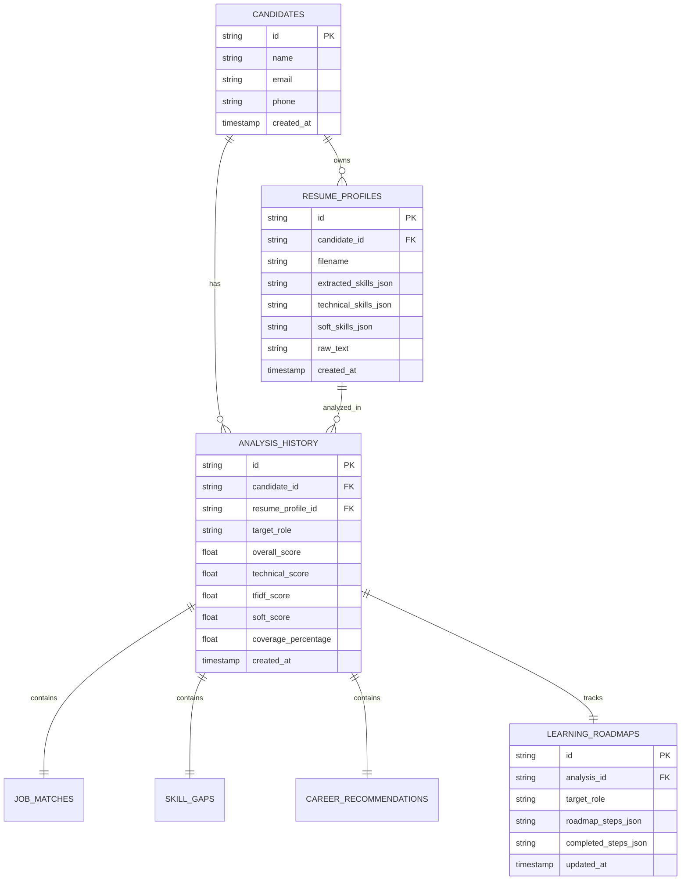

# ⚡ SkillMatch AI – Smart Career Compatibility Analyzer

An intelligent, full-stack career analytics platform that leverages **Natural Language Processing (NLP)**, **TF-IDF Vectorization**, and **Supervised Machine Learning** with an embedded **SQLite Database** to measure resume-job compatibility, diagnose critical skill gaps, benchmark multiple job roles, track upskilling milestones, and generate downloadable executive PDF reports.

---

## 🌟 Key Highlights & Upgrades

- **Permanent SQLite Persistence (`database/skillmatch.db`)**: Automatically retains candidate profiles, historical analyses, matching breakdowns, and roadmap milestone progress across browser refreshes and server restarts.
- **Side-by-Side Multi-Role Comparison**: Simultaneously benchmark compatibility across 2 to 4 tech roles with comparative Plotly bar charts and metric cards.
- **Milestone Progress Tracking**: Interactive checklist on learning roadmaps allowing candidates to mark completed skills with progress retained in SQLite.
- **100% Client-Side Privacy**: All PDF parsing, NLP extraction, and model inference run locally in memory. No user resume data or personal information is transmitted to third-party paid APIs.
- **Transparent Mathematical Scoring**: Unlike black-box Applicant Tracking Systems (ATS), SkillMatch AI details its exact scoring equation—combining 50% core technical match, 35% TF-IDF semantic alignment, 15% soft skills alignment, and bonus breadth points.
- **Curated Taxonomy & Alias Resolution**: Recognizes over 500+ skills across software engineering, machine learning, cloud/DevOps, cybersecurity, and data analytics, automatically resolving aliases (e.g., `k8s` → `Kubernetes`, `postgres` → `PostgreSQL`, `sklearn` → `Scikit-learn`).
- **Supervised Role Classification**: Evaluates candidate resumes with a trained Scikit-learn classifier to predict domain affinity (Data & Analytics, Software Engineering, Cloud & Infrastructure, Cybersecurity, Business Intelligence).
- **Executive PDF Dossier**: Produces multi-page, formatted PDF career reports via ReportLab with one-click download.

---

## 🏗️ Project Architecture & Directory Structure

```text
SkillMatch-AI/
│
├── app.py                         # Landing page, recent analyses, demo loader (PAGE 1)
├── requirements.txt               # Complete project dependencies
├── README.md                      # Comprehensive developer & user guide
├── PROJECT_REPORT.md              # Academic ML submission report
├── TECHNICAL_AUDIT.md             # Technical audit and repair report
├── data_init.py                   # Taxonomy and dataset builder
├── train_models.py                # ML model training with Stratified K-Fold CV
├── verify_pages_e2e.py            # End-to-end critical workflow test runner
│
├── database/
│   └── skillmatch.db              # SQLite permanent database (7 relational tables)
│
├── data/
│   ├── job_roles.csv              # Curated dataset of 15 industry benchmark job profiles
│   ├── skills_taxonomy.json       # Hierarchical taxonomy with 500+ tech & soft skills + aliases
│   └── learning_resources.json    # Verified learning curriculum and resource URLs
│
├── models/
│   ├── tfidf_vectorizer.pkl       # Serialized TF-IDF vectorizer (unigrams + bigrams)
│   ├── category_classifier.pkl    # Supervised Logistic Regression domain classifier
│   ├── category_label_encoder.pkl # Domain label encoder
│   ├── role_classifier.pkl        # Role-level supervised classifier
│   ├── role_label_encoder.pkl     # Role label encoder
│   └── model_metadata.json        # Training evaluation metrics and class distributions
│
├── modules/
│   ├── database.py                # SQLite DatabaseManager (CRUD operations & schema)
│   ├── text_preprocessing.py      # Cleans text, tokenizes, preserves tokens (C++, C#, .NET, CI/CD)
│   ├── resume_parser.py           # PyMuPDF PDF extraction, contact, education & experience parsing
│   ├── skill_extractor.py         # Boundary-aware regex taxonomy matching & alias resolution
│   ├── job_matcher.py             # TF-IDF Cosine Similarity & Weighted Compatibility engine
│   ├── career_recommender.py      # Cross-role ranking & domain affinity predictions
│   ├── skill_gap_analyzer.py      # Critical / High / Medium gap prioritization
│   ├── roadmap_generator.py       # Phased learning curriculum sequencer
│   └── report_generator.py        # Executive PDF report generation using ReportLab
│
├── pages/
│   ├── 1_📄_Resume_Analyzer.py     # Resume upload, profile cards, interactive skill editor
│   ├── 2_🎯_Job_Matching.py       # Predefined/Custom role match, Multi-Role Comparison
│   ├── 3_🔍_Skill_Gap_Analysis.py # Gap matrix, visual bar/donut charts, action items
│   ├── 4_🚀_Career_Recommendations.py # Multi-domain recommendations, ML confidence charts
│   ├── 5_🗺️_Learning_Roadmap.py    # Phased timeline (Weeks 1-12) & milestone progress checkboxes
│   ├── 6_📊_Analytics_Dashboard.py # Cross-role benchmarks, skill distribution, readiness index
│   ├── 7_📥_Download_Report.py    # Live summary checklist & instant PDF export
│   └── 8_📜_Analysis_History.py   # Saved evaluations in SQLite with 1-click restore & delete
│
├── assets/
│   └── samples/                   # 4 realistic sample PDF resumes for 1-click testing
│       ├── Sample_Data_Scientist.pdf
│       ├── Sample_FullStack_Developer.pdf
│       ├── Sample_DevOps_Engineer.pdf
│       └── Sample_Fresh_Graduate.pdf
│
├── tests/
│   ├── test_database.py           # Unit tests for SQLite database operations
│   ├── test_resume_parser.py      # Unit tests for PDF parsing and contact extraction
│   ├── test_skill_extractor.py    # Unit tests for taxonomy matching and alias resolution
│   ├── test_job_matcher.py        # Unit tests for scoring engine and ranking
│   ├── test_gap_and_roadmap.py    # Unit tests for gap analysis and roadmap generation
│   └── test_report_generator.py   # Unit tests for PDF buffer creation
│
└── utils/
    ├── helpers.py                 # Theme injector, circular meters, session state sync
    └── sample_resumes.py          # Generator script for test PDF resumes
```

---

## 💾 Permanent SQLite Database Schema

The database `database/skillmatch.db` manages 7 relational tables with foreign keys and automatic indexing:



---

## ⚙️ Technology Stack

| Component | Technology | Version | Purpose |
| :--- | :--- | :--- | :--- |
| **Language** | Python | 3.11+ / 3.13 | Core runtime |
| **Frontend Framework** | Streamlit | 1.35+ | Modern multi-page SaaS web interface |
| **Database** | SQLite3 | Embedded | Relational permanent persistence (`database/skillmatch.db`) |
| **Machine Learning** | Scikit-learn, NumPy, Pandas | Latest | TF-IDF, Logistic Regression, Cosine Similarity |
| **Natural Language Processing** | NLTK | 3.9+ | Tokenization, WordNet lemmatization, stopword cleaning |
| **PDF Extraction** | PyMuPDF (fitz) | 1.24+ | Text, layout, and metadata extraction |
| **Data Visualization** | Plotly Express & Graph Objects | 5.22+ | Circular gauges, comparative bars, donut distributions |
| **PDF Report Generation** | ReportLab | 4.2+ | In-memory publication-quality PDF dossiers |
| **Serialization** | Joblib | 1.4+ | Model persistence (`.pkl`) |
| **Automated Testing** | Pytest | 8.0+ | 18 unit and integration test cases |

---

## 📐 Machine Learning & Scoring Methodology

### 1. Hybrid Compatibility Index

The core compatibility score ($S$) is computed using a weighted multi-factor formula:

$$S = \text{clamp}\Big( w_{tech} \cdot S_{tech} + w_{tfidf} \cdot S_{tfidf} + w_{soft} \cdot S_{soft} + B_{bonus},\; 0,\; 100 \Big)$$

Where:
- **$S_{tech}$ (Technical Overlap %)**:
  $$S_{tech} = \frac{|\text{Possessed Tech Skills} \cap \text{Required Tech Skills}|}{|\text{Required Tech Skills}|} \times 100$$
- **$S_{tfidf}$ (Semantic Similarity %)**:
  $$S_{tfidf} = \frac{\mathbf{v}_{resume} \cdot \mathbf{v}_{jd}}{\|\mathbf{v}_{resume}\| \|\mathbf{v}_{jd}\|} \times 100$$
  Derived from sublinear TF-IDF vectors fitted with unigrams and bigrams.
- **$S_{soft}$ (Soft Skills Alignment %)**:
  $$S_{soft} = \frac{|\text{Possessed Soft Skills} \cap \text{Required Soft Skills}|}{|\text{Required Soft Skills}|} \times 100$$
- **$B_{bonus}$ (Breadth Bonus)**:
  $$B_{bonus} = \min(5.0,\; |\text{Additional Candidate Skills}| \times 0.5)$$
- **Default Weights**: $w_{tech} = 0.50$, $w_{tfidf} = 0.35$, $w_{soft} = 0.15$. (Customizable via interactive UI slider).

> [!IMPORTANT]
> **Transparency Disclaimer**: The compatibility score reflects semantic and skill alignment against the specified job requirements. It is a benchmark of candidate profile readiness and is **not a statistical probability or guarantee of employment**.

### 2. Supervised Job Domain Classifier
A multiclass Logistic Regression model was trained on representative career variations across 5 domains:
`Data & Analytics`, `Software Engineering`, `Cloud & Infrastructure`, `Cybersecurity`, and `Business & Analytics`.
- **Validation**: Evaluated using Stratified 5-Fold Cross-Validation, achieving $88.33\% \pm 4.08\%$ mean accuracy.
- **Dataset Disclosure**: Curated starter benchmark dataset composed of 15 industry roles with representative phrasing variations.

---

## 🚀 Quick Start & Installation

### Step 1: Navigate to Project
```bash
cd "d:\SkillMatch AI"
```

### Step 2: Install Dependencies
```bash
pip install -r requirements.txt
```

### Step 3: Run the Application
```bash
python -m streamlit run app.py
```
Open your browser to: **`http://localhost:8501`**

---

## 🧪 Running Automated Tests

Run the complete test suite with `pytest`:
```bash
python -m pytest tests/ -v
```
All **18 automated test cases** validate database CRUD operations, text extraction, alias resolution, boundary tokens, scoring constraints, and PDF generation.

To test the critical end-to-end workflow (Upload → Match → Save → Refresh → Retrieve):
```bash
python verify_pages_e2e.py
```

---

## 🖥️ Application Pages Overview

1. **PAGE 1: Home / Landing Page (`app.py`)**
   - Deep navy / gradient hero section.
   - Dynamic real-time statistics (500+ skills in taxonomy, 15 benchmark roles, saved analyses count).
   - "How It Works" 4-step workflow cards.
   - Recent Analysis History cards loaded directly from SQLite with 1-click restore.
   - Sidebar 1-click demo resume loader (Data Scientist, Full Stack, DevOps, Fresh Graduate).

2. **PAGE 2: Resume Analyzer (`pages/1_📄_Resume_Analyzer.py`)**
   - Drag-and-drop PDF resume upload with PyMuPDF parser.
   - Contact extraction (Email, Phone, LinkedIn, GitHub).
   - Academic degrees & years of experience estimation.
   - Categorized skill tags (Technical by subcategory, Soft skills).
   - Interactive Skill Manager to dynamically add or remove skills with automatic SQLite update.

3. **PAGE 3: Job Matching (`pages/2_🎯_Job_Matching.py`)**
   - Select from 15 predefined benchmark roles or paste custom job postings.
   - **Compare Job Roles Tab:** Side-by-side benchmarking of 2 to 4 roles simultaneously with comparative Plotly bar charts.
   - Circular compatibility indicator (0 - 100%).
   - Scoring breakdown (Technical, TF-IDF Semantic, Soft Skills, Coverage Ratio).
   - Matched vs Missing vs Bonus skills badges.
   - **"Save Analysis to Database"** button.

4. **PAGE 4: Skill Gap Analysis (`pages/3_🔍_Skill_Gap_Analysis.py`)**
   - Possessed vs. Missing bar and donut composition charts.
   - Missing skills prioritized into **Critical**, **High**, and **Medium** tiers.
   - Actionable strategic recommendations.

5. **PAGE 5: Career Recommendations (`pages/4_🚀_Career_Recommendations.py`)**
   - Supervised ML domain classification with confidence distribution chart.
   - Ranked job roles with match percentages and tailored rationale.
   - Filter by domain (Data, Software, Cloud, Security) and 1-click role targeting.

6. **PAGE 6: Learning Roadmap (`pages/5_🗺️_Learning_Roadmap.py`)**
   - Phased timeline sequence (Weeks 1 to 12).
   - 3 learning stages per missing skill: **Beginner**, **Intermediate**, and **Advanced**.
   - Verified learning resources (Official Docs, freeCodeCamp, Coursera, Kaggle, roadmap.sh).
   - **Milestone Completion Tracking:** Check off milestones with progress bar and permanent SQLite synchronization.

7. **PAGE 7: Analytics Dashboard (`pages/6_📊_Analytics_Dashboard.py`)**
   - Executive summary KPI cards.
   - Full 15-role horizontal compatibility benchmark bar chart.
   - Career Readiness Index calculation.
   - Skills distribution by subdomain and market-wide top asset/gap lists.

8. **PAGE 8: Download Report (`pages/7_📥_Download_Report.py`)**
   - PDF preview audit checklist.
   - One-click ReportLab PDF generation and instant download.

9. **PAGE 9: Analysis History & Saved Profiles (`pages/8_📜_Analysis_History.py`)**
   - Full historical audit trail of all saved evaluations.
   - "Reopen Analysis" action (reloads all state into active session).
   - Single deletion and confirmed history clearing.

---

## 🔒 Privacy & Security

SkillMatch AI is designed with strict data privacy:
- Resumes are parsed in memory using PyMuPDF.
- All database operations are stored locally in `database/skillmatch.db`.
- No external calls are made to commercial AI APIs (OpenAI, Anthropic, Google Cloud APIs).
- Personal candidate data is never transmitted across the network.

---

## 📄 License
MIT License. Created for education, career development, and portfolio demonstration.
